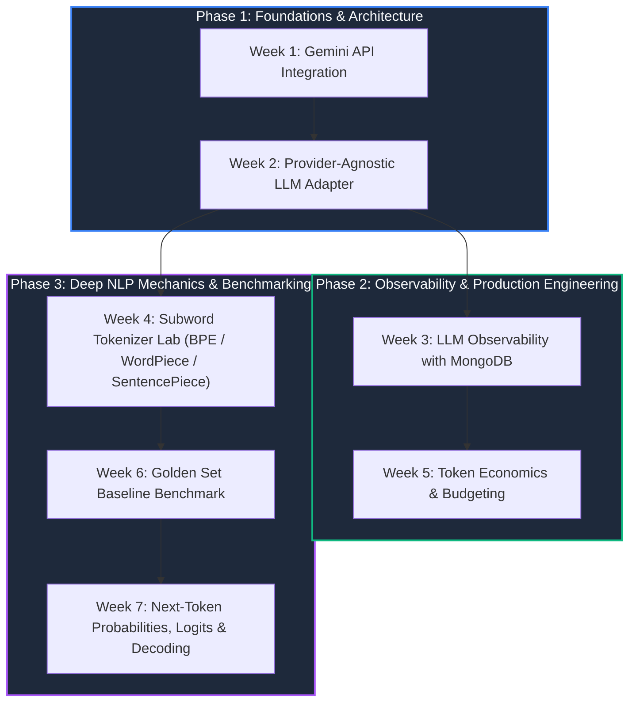

<div align="center">

# 🧠 Generative AI Lab Experiments
### *End-to-End Practical Labs: From Core LLM APIs to Deep Mechanics & Production Systems*

[](https://www.python.org/)
[](https://ai.google.dev/)
[](https://pytorch.org/)
[](https://huggingface.co/)
[](https://www.mongodb.com/atlas)
[](https://ollama.ai/)
[](https://pytest.org/)
[](https://opensource.org/licenses/MIT)

<p align="center">
  <a href="#-experiments-roadmap">Roadmap</a> •
  <a href="#-weekly-curriculum">Weekly Curriculum</a> •
  <a href="#-repository-structure">Project Structure</a> •
  <a href="#-quick-start">Quick Start</a> •
  <a href="#-deep-dive-by-week">Deep Dives</a> •
  <a href="#-security--best-practices">Security</a>
</p>

---

</div>

## 📌 Overview

This repository hosts a progressive, production-grade curriculum of **Generative AI Laboratory Experiments**. Each week delves into a distinct layer of modern AI engineering—spanning raw API integration, provider-agnostic abstractions, real-time observability, multilingual subword tokenization, token cost economics, benchmark evaluation, and next-token probability distribution mechanics.

---

## 🗺 Experiments Roadmap



---

## 📚 Weekly Curriculum

| Week | Title | Core Concepts | Primary Tech Stack | Status |
| :---: | :--- | :--- | :--- | :---: |
| [**01**](week1/README.md) | **Google Gemini API Foundations** | Text generation, parameter tuning, environment secrets management | Google GenAI SDK (`gemini-3.5-flash-lite`), `python-dotenv` | `Completed` |
| [**02**](week2/README.md) | **Provider-Agnostic LLM Client** | Strategy Design Pattern, swappable backends, mockable unit testing | Python ABC, Ollama (`llama3.2`), Gemini API, `pytest` | `Completed` |
| [**03**](week3/README.md) | **LLM Observability & Telemetry** | Token auditing, latency tracking, retry mechanisms, cloud persistence | PyMongo, MongoDB Atlas Cloud, Fault Tolerance | `Completed` |
| [**04**](week4/README.md) | **Tokenizer Comparison Lab** | Subword segmentation, fertility rate, cross-lingual efficiency (EN/TE/HI) | BPE (`gpt2`), WordPiece (`bert`), SentencePiece (`xlm-roberta`) | `Completed` |
| [**05**](week5/README.md) | **Token Economics & Feature Budgeting** | Pre-build forecasting, RPM/TPM thresholds, cost runway models | Python Dataclasses, Budget Analysis, `pytest` | `Completed` |
| [**06**](week6/README.md) | **Golden Question Benchmark (v0.1)** | Curated 30-prompt evaluation dataset, keyword scoring against local LLM | Ollama, Llama 3.2, Automated CSV & JSON Benchmarking | `Completed` |
| [**07**](week7/README.md) | **Next-Token Probabilities & Logits** | Logits extraction, temperature scaling ($z/T$), Softmax & top-$k$ sampling | PyTorch, Hugging Face (`gpt2`), Next-Token Distribution | `Completed` |

---

## 📂 Repository Structure

```text
Generative-AI-/
├── .gitignore                    # Global git ignore (safeguards .env, .venv, caches)
├── README.md                     # Master laboratory documentation (You are here)
│
├── week1/                        # Week 1: Gemini API Foundations
│   ├── .env.example              # Environment variables template
│   ├── main.py                   # Generation script
│   ├── requirements.txt          # Module dependencies
│   └── README.md
│
├── week2/                        # Week 2: Provider-Agnostic LLM Client
│   ├── .env.example
│   ├── llm_client.py             # Strategy pattern LLM interface & adapters
│   ├── main.py                   # Demonstration runner
│   ├── test_client.py            # Automated unit tests
│   ├── requirements.txt
│   └── README.md
│
├── week3/                        # Week 3: LLM Observability with MongoDB
│   ├── .env.example
│   ├── usage_logger.py           # MongoDB Atlas telemetry logger & cost tracker
│   ├── llm_client.py             # Instrumented client with retry policies
│   ├── main.py                   # Real-time execution logger
│   ├── test_client.py            # Unit tests for logging & retries
│   ├── requirements.txt
│   └── README.md
│
├── week4/                        # Week 4: Subword Tokenizer Lab
│   ├── tokenizer_comparison.py   # Multi-script BPE vs WordPiece vs SentencePiece
│   ├── requirements.txt
│   └── README.md
│
├── week5/                        # Week 5: Token Economics & Cost Budgeting
│   ├── .env.example
│   ├── budget.py                 # Economics calculator & capacity planner
│   ├── test_budget.py            # Automated test suite for budget thresholds
│   ├── requirements.txt
│   └── README.md
│
├── week6/                        # Week 6: Golden Set Baseline Benchmark
│   ├── golden_set.json           # 30 curated prompts across 6 domain categories
│   ├── main.py                   # Evaluator querying Ollama with keyword validation
│   ├── baseline_results.csv      # Generated benchmark score results
│   ├── requirements.txt
│   └── README.md
│
└── week7/                        # Week 7: Next-Token Probabilities & Logits
    ├── main.py                   # Interactive next-token distribution analyzer
    ├── requirements.txt          # PyTorch & Hugging Face Transformers
    └── README.md
```

---

## 🚀 Quick Start

### 1. Clone the Repository
```bash
git clone https://github.com/SurajReddy469/Generative-AI-.git
cd Generative-AI-
```

### 2. Setup Virtual Environment
```powershell
# Create virtual environment
python -m venv .venv

# Activate on Windows PowerShell
.\.venv\Scripts\Activate.ps1

# Activate on Linux/macOS
# source .venv/bin/activate
```

### 3. Configure Environment Variables
Copy `.env.example` templates to `.env` in the required week folders and populate your API credentials:
```powershell
# Example for Week 1
Copy-Item week1\.env.example week1\.env
```
> [!NOTE]
> `.env` files are strictly ignored by `.gitignore` to prevent any secret leakages to version control.

---

## 🔍 Deep Dive by Week

<details>
<summary><b>Week 1: Getting Started with Google Gemini API</b></summary>

* **Aim:** Setup authenticated environment, configure generation parameters (temperature, max tokens), and stream responses using the Google GenAI SDK.
* **Run:**
  ```powershell
  cd week1
  pip install -r requirements.txt
  python main.py
  ```
</details>

<details>
<summary><b>Week 2: Provider-Agnostic LLM Client</b></summary>

* **Aim:** Implement a clean architecture using the **Strategy Design Pattern** that decouples application logic from specific model providers (Google Gemini cloud vs. local Ollama / Llama 3.2).
* **Run:**
  ```powershell
  cd week2
  pip install -r requirements.txt
  python main.py
  pytest test_client.py -v
  ```
</details>

<details>
<summary><b>Week 3: LLM Observability & Telemetry with MongoDB</b></summary>

* **Aim:** Build production observability for GenAI applications. Logs input/output token counts, measured latency in milliseconds, estimated financial cost, and provider metadata into a MongoDB Atlas collection (`llm_monitoring.api_usage`) with exponential backoff and timeout handling.
* **Run:**
  ```powershell
  cd week3
  pip install -r requirements.txt
  python main.py
  pytest test_client.py -v
  ```
</details>

<details>
<summary><b>Week 4: Tokenizer Lab: BPE vs. WordPiece vs. SentencePiece</b></summary>

* **Aim:** Compare subword segmentation algorithms across English, Telugu, and Hindi. Evaluates tokenizer fertility rate, subword fragmentation, and byte-level handling using GPT-2 (BPE), Multilingual BERT (WordPiece), and XLM-RoBERTa (SentencePiece).
* **Run:**
  ```powershell
  cd week4
  pip install -r requirements.txt
  python tokenizer_comparison.py
  ```
</details>

<details>
<summary><b>Week 5: Token Economics & Feature Budgeting</b></summary>

* **Aim:** Implement pre-deployment mathematical budgeting for GenAI features. Calculates daily/monthly spend forecasts, checks RPM/TPM provider limits, and simulates stress safety margins.
* **Run:**
  ```powershell
  cd week5
  pip install -r requirements.txt
  python budget.py
  pytest test_budget.py -v
  ```
</details>

<details>
<summary><b>Week 6: Golden Question Benchmark (Release v0.1)</b></summary>

* **Aim:** Establish an automated evaluation baseline. Tests local `llama3.2` against a curated 30-question dataset spanning Reasoning, Coding, Math, Summarization, Extraction, and Safety, scoring responses based on mandatory keyword presence.
* **Run:**
  ```powershell
  cd week6
  pip install -r requirements.txt
  python main.py
  ```
</details>

<details>
<summary><b>Week 7: Next-Token Probabilities, Logits & Decoding</b></summary>

* **Aim:** Uncover how autoregressive language models predict tokens. Extracts raw logits from `openai-community/gpt2`, applies temperature scaling ($z/T$), performs Softmax normalization, visualizes candidate probability distribution bars, and exports the top-$k$ tokens to CSV.
* **Run:**
  ```powershell
  cd week7
  pip install -r requirements.txt
  python main.py
  ```
</details>

---

## 🧪 Running Automated Unit Tests

To verify client resilience, fallback strategies, and budget validation across the repository, execute:

```powershell
pytest week2/test_client.py week3/test_client.py week5/test_budget.py -v
```

---

## 🔒 Security & Best Practices

- **Zero-Secret Commitment**: Sensitive configuration keys (`GEMINI_API_KEY`, `MONGODB_URI`) are loaded via local `.env` files and strictly protected by [.gitignore](.gitignore).
- **Graceful Fallbacks**: Production clients feature retry loops, connection timeouts, and offline unit test mocks.
- **Provider Portability**: Modular abstraction ensures seamless switching between cloud LLMs (Gemini) and on-premise local models (Ollama).

---

## 👨‍💻 Author

**Chalamalla Suraj Reddy**  
- GitHub: [@SurajReddy469](https://github.com/SurajReddy469)  
- Repository: [Generative-AI-](https://github.com/SurajReddy469/Generative-AI-)

---

<div align="center">
  <sub>Built with ❤️ for Generative AI Engineering & Research</sub>
</div>
