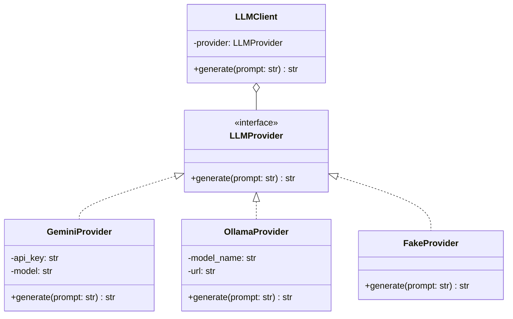

# Week 2: Provider-Agnostic LLM Client

[](https://www.python.org/)
[]()
[](https://ollama.ai/)
[](https://pytest.org/)
[]()

## Aim
To design and build a provider-agnostic LLM client using the **Strategy / Adapter design pattern**. The client provides a uniform `LLMClient.generate(prompt)` interface across both cloud-hosted APIs (Google Gemini) and locally served offline models (Ollama running `llama3.2`), coupled with isolated unit tests using test doubles (`FakeProvider`).

---

## Architecture



---

## Prerequisites & Credentials
1. **Google Gemini API Key**: For cloud inference.
2. **Ollama (Local LLM)**: For local offline inference.
   - Install Ollama from [ollama.ai](https://ollama.ai).
   - Start the service: `ollama serve` (runs at `http://localhost:11434`).
   - Pull the model:
     ```powershell
     ollama pull llama3.2
     ```

---

## Project Structure
```text
week2/
├── .env.example       # Template for Gemini API key
├── .env               # Local environment credentials (git-ignored)
├── .gitignore         # Ignores .env and test caches
├── llm_client.py      # Core interfaces, GeminiProvider, OllamaProvider, LLMClient
├── main.py            # Interactive CLI application
├── test_client.py     # Automated unit test suite (using FakeProvider)
├── requirements.txt   # Dependencies (google-genai, requests, python-dotenv, pytest)
└── README.md          # Week 2 guide
```

---

## How to Run Week 2

### Step 1: Install Dependencies
From the repository root (or within `week2/`):
```powershell
pip install -r week2/requirements.txt
```

### Step 2: Configure Environment Variables
Copy `.env.example` to `.env`:

**PowerShell (Windows):**
```powershell
Copy-Item week2\.env.example week2\.env
```

**Bash (Linux / macOS):**
```bash
cp week2/.env.example week2/.env
```

Edit `week2/.env` to add your Gemini API key:
```env
GEMINI_API_KEY=your_actual_gemini_api_key_here
```

### Step 3: Run Automated Unit Tests
Verify the client abstraction without making real API calls:

```powershell
# From repository root
pytest week2/test_client.py -v

# Or using unittest
python -m unittest week2/test_client.py
```

### Step 4: Run the Interactive Client

#### Option A: Run directly from Repository Root (Recommended)
```powershell
python week2/main.py
```

#### Option B: Run from inside `week2/`
```powershell
cd week2
python main.py
```

---

## Sample Interactions & Outputs

### Case 1: Running with Google Gemini
```text
Choose provider (gemini/ollama): gemini
Enter your question: Explain the Strategy Pattern in 2 lines.

=============== Week2 ======================

LLM Response:
The Strategy Pattern defines a family of algorithms, encapsulates each one, and makes them interchangeable.
It allows the algorithm to vary independently from the clients that use it.
```

### Case 2: Running with Local Ollama (`llama3.2`)
```text
Choose provider (gemini/ollama): ollama
Enter your question: What is Docker?

=============== Week2 ======================

LLM Response:
Docker is an open-source platform that automates the deployment, scaling, and management of applications inside lightweight, portable containers.
```

---

## Troubleshooting

| Issue | Cause | Fix |
| :--- | :--- | :--- |
| `requests.exceptions.ConnectionError: Failed to connect to localhost:11434` | Ollama daemon is not running | Start Ollama with `ollama serve` or launch the Ollama desktop app. |
| `model "llama3.2" not found` | The model has not been downloaded locally | Run `ollama pull llama3.2` in a terminal. |
| `ValueError: Gemini API key not found in .env` | `week2/.env` is missing or key is blank | Copy `week2/.env.example` to `week2/.env` and supply your Gemini key. |
| `ModuleNotFoundError: No module named 'llm_client'` | Running from outside the directory | Resolved automatically via `sys.path.insert(0, str(Path(__file__).parent))` in `main.py` and `test_client.py`. |
