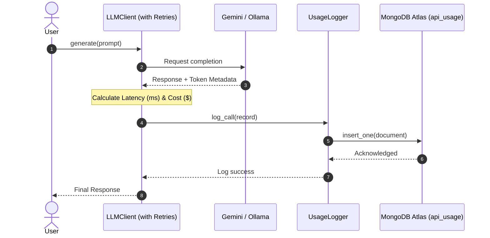

# Week 3: LLM Observability & Monitoring with MongoDB

[](https://www.python.org/)
[](https://www.mongodb.com/atlas)
[](https://ai.google.dev/)
[](https://ollama.ai/)
[](https://pytest.org/)
[]()

## Aim
To implement full-lifecycle observability for LLM interactions. The client automatically captures prompt/response token counts, measures millisecond latency via `time.perf_counter()`, estimates query cost, applies exponential backoff retries for transient HTTP errors, and persists structured logs into MongoDB Atlas (`llm_monitoring.api_usage`).

---

## Observability Flow



---

## Prerequisites & Credentials

1. **MongoDB Atlas Account & Cluster**:
   - Create a free M0 cluster at [cloud.mongodb.com](https://cloud.mongodb.com).
   - Under **Security > Database Access**: Create a database user (e.g. `db_user`) with read/write privileges.
   - Under **Security > Network Access**: Add an IP access entry. For testing, add `0.0.0.0/0` (Allow Access from Anywhere) or your current public IP.
   - Under **Deployment > Database > Connect**: Choose **Drivers (Python)** to copy the connection string.
2. **Google Gemini API Key**:
   - Active key from [Google AI Studio](https://aistudio.google.com/).
3. **Ollama (Optional for local testing)**:
   - Ensure Ollama daemon is running with `llama3.2` pulled.

---

## Project Structure
```text
week3/
├── .env.example       # Template for MongoDB URI and Gemini API key
├── .env               # Local secrets (git-ignored)
├── .gitignore         # Ignores .env and cache
├── usage_logger.py    # MongoDB connection and resilient logging engine
├── llm_client.py      # LLMProvider, Gemini/Ollama adapters, retry mechanism
├── main.py            # Main interactive telemetry application
├── test_client.py     # Unit test suite using FakeProvider & FakeLogger
├── requirements.txt   # Dependencies (pymongo, google-genai, requests, pytest)
└── README.md          # Week 3 guide
```

---

## How to Run Week 3

### Step 1: Install Dependencies
From the repository root (or within `week3/`):
```powershell
pip install -r week3/requirements.txt
```

### Step 2: Configure Environment Variables
Copy `.env.example` to `.env`:

**PowerShell (Windows):**
```powershell
Copy-Item week3\.env.example week3\.env
```

**Bash (Linux / macOS):**
```bash
cp week3/.env.example week3/.env
```

Edit `week3/.env` with your real credentials:
```env
GEMINI_API_KEY=your_actual_gemini_api_key_here
MONGODB_URI=mongodb+srv://<username>:<password>@cluster0.xxxxx.mongodb.net/?retryWrites=true&w=majority&appName=Cluster0
GEMINI_INPUT_PRICE_PER_MILLION=0.15
GEMINI_OUTPUT_PRICE_PER_MILLION=0.60
```
> [!IMPORTANT]
> Make sure to replace `<username>` and `<password>` without literal angle brackets `<` or `>`.

### Step 3: Run Automated Unit Tests
Verify logging and token calculations offline:
```powershell
# From repository root
pytest week3/test_client.py -v

# Or using unittest
python -m unittest week3/test_client.py
```

### Step 4: Run the Interactive Telemetry Application

#### Option A: Run directly from Repository Root (Recommended)
```powershell
python week3/main.py
```

#### Option B: Run from inside `week3/`
```powershell
cd week3
python main.py
```

---

## Sample Interaction & Output

```text
Choose provider (gemini/ollama): gemini
Enter your question: What is database observability?
Usage details saved to MongoDB.
==================== Week3 ================

LLM Response:
Database observability refers to the ability to monitor, measure, and understand the internal state of a database system based on its external outputs (metrics, logs, traces)...
```

### Sample Record Saved in MongoDB Atlas (`llm_monitoring.api_usage`):
```json
{
  "_id": {"$oid": "6733230a84e6f46115fa01bc"},
  "provider": "Gemini",
  "model": "gemini-3.5-flash-lite",
  "prompt": "What is database observability?",
  "input_tokens": 6,
  "output_tokens": 124,
  "total_tokens": 130,
  "latency_ms": 782.4,
  "cost_usd": 0.0000753,
  "status": "success",
  "timestamp": {"$date": "2026-11-18T07:22:18.000Z"}
}
```

---

## Troubleshooting

| Issue | Cause | Fix |
| :--- | :--- | :--- |
| `ServerSelectionTimeoutError: SSL handshake failed: tlsv1 alert internal error` | Client IP is not whitelisted in MongoDB Atlas | Go to MongoDB Atlas -> **Network Access** -> Click **Add IP Address** -> Select **Allow Access From Anywhere** (`0.0.0.0/0`) or your current IP. |
| `OperationFailure: bad auth : authentication failed` | Password contains `<` `>` or wrong credentials | Edit `week3/.env` and replace `<password>` with plain password (e.g., `qwerty098`, not `<qwerty098>`). |
| `ValueError: MONGODB_URI is not configured in week3/.env` | The `.env` file is missing or still contains placeholder text | Replace placeholder URL with your real Atlas connection string. |
| `requests.exceptions.ConnectionError: Failed to connect to localhost:11434` | Ollama service is stopped | Start Ollama with `ollama serve`. |
