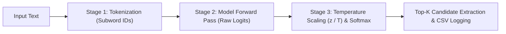

# Week 7: Next-Token Probabilities, Logits & Decoding

## Aim
To implement an interactive deep-dive into the token generation pipeline of an autoregressive language model (`openai-community/gpt2`). The tool demonstrates how input text is tokenized, how raw scores (logits) across the vocabulary are computed, how temperature scaling shapes the probability distribution via Softmax, and logs the top-$k$ candidate predictions into a CSV file.

---

## Generation Stages



1. **Stage 1: Input Tokenization**
   * Breaks prompt into BPE subword tokens and maps them to vocabulary IDs.
2. **Stage 2: Raw Model Scores (Logits)**
   * Computes unnormalized scores across all 50,257 vocabulary tokens for the position following the prompt.
3. **Stage 3: Temperature & Softmax Scaling**
   * Scaled Logits: $s_i = \frac{z_i}{T}$
   * Probability Distribution:
     $$P(w_i) = \frac{e^{z_i / T}}{\sum_{j=1}^{V} e^{z_j / T}}$$
   * **Low Temperature ($T < 1.0$):** Sharpens the distribution; high-probability tokens dominate (more deterministic).
   * **High Temperature ($T > 1.0$):** Flattens the distribution; tail tokens get higher relative probability (more diverse/random).
4. **Top-$K$ Candidates & CSV Export**
   * Displays rank, token ID, decoded token piece, raw logit, scaled logit, probability percentage, and visual probability bar.
   * Exports records to `gpt2_next_token_results.csv`.

---

## Project Structure
```text
week7/
├── .gitignore                    # Ignores .venv, cache, and CSV results
├── gpt2_next_token_results.csv   # Auto-generated CSV with run history
├── main.py                       # Interactive next-token distribution analyzer
├── README.md                     # Documentation
└── requirements.txt              # Dependencies (torch, transformers)
```

---

## Setup & Execution

1. **Install dependencies:**
   ```powershell
   pip install -r requirements.txt
   ```

2. **Run the interactive tool:**
   ```powershell
   python main.py
   ```

3. **Sample Interaction:**
   ```text
   Enter prompt: The capital of France is
   Enter top-k candidates to display [default = 6]: 5
   Enter temperature [default = 1.0]: 0.7
   ```
